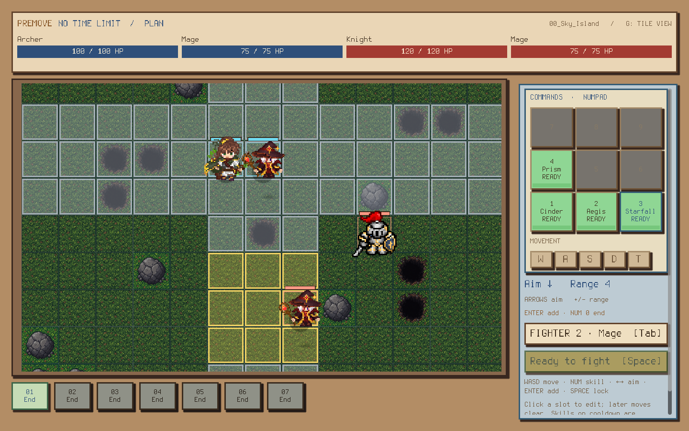
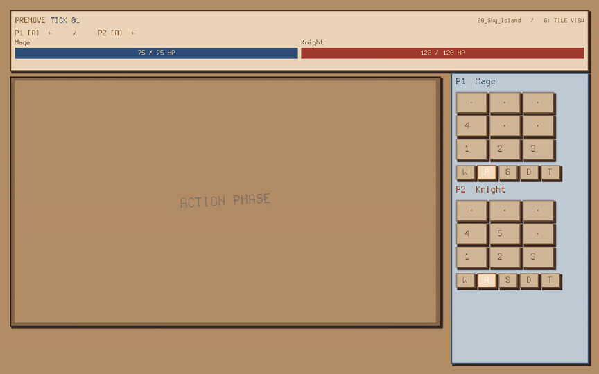
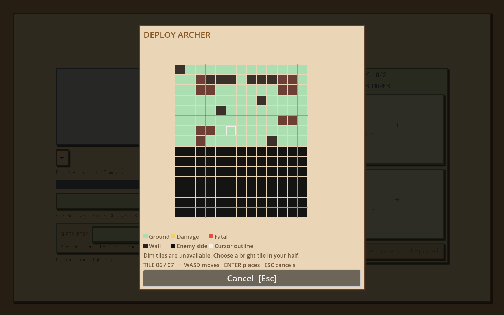
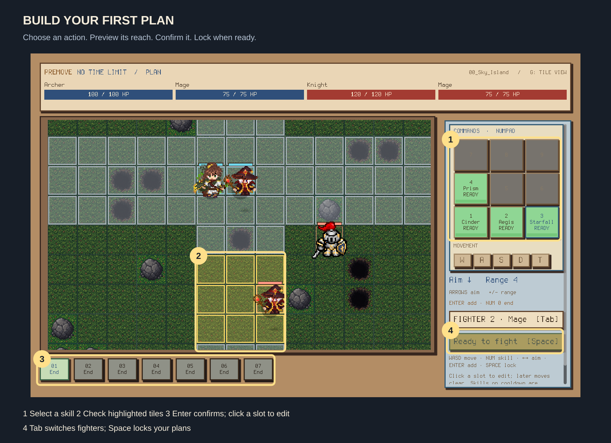
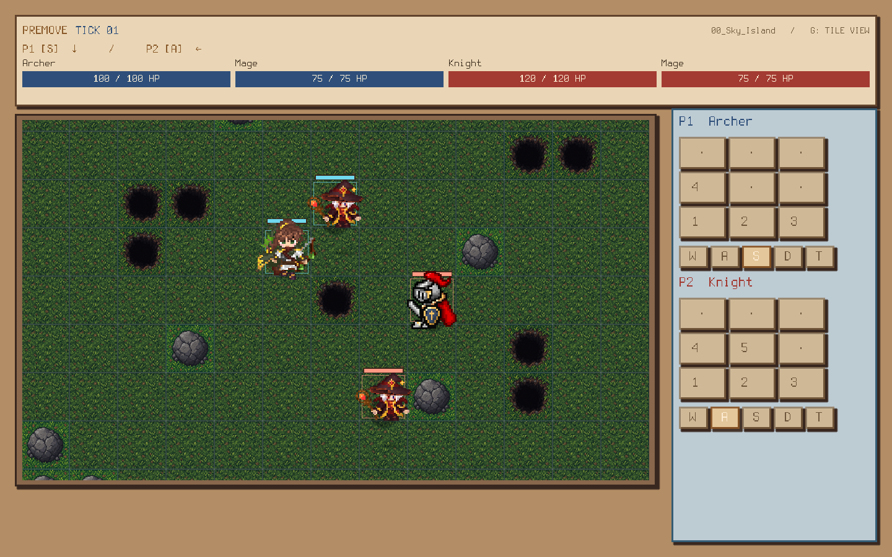

# Premove

**Plan in secret. Resolve together.**

Premove is a pixel-art tactics game where both players choose their moves before either side acts. Build a team, predict where your opponent will go, and watch both plans play out at the same time. Defeat the opposing team to win.



[Watch the demo](assets/presentation/premove-demo.mp4) · [Learn to play](#your-first-match) · [Run locally](#run-locally) · [Presentation guide](docs/PRESENTATION.md)

## Demo



**[Watch the full gameplay recording with audio →](assets/presentation/premove-demo.mp4)**

Recorded directly from the running game at normal speed. The GIF loops a combat exchange; the MP4 includes team setup, private planning, movement, and attacks.

## The game at a glance

| | |
| --- | --- |
| Core idea | Predict your opponent's next position before committing to an attack. |
| Match flow | Deploy → plan privately → lock plans → choose a fighter → resolve together. |
| Ways to play | Practice against the computer, share one computer, or connect over LAN. |
| Teams | One to three fighters, with repeat classes allowed. |
| Playable classes | Knight, Mage, and Archer. Orc is coming soon. |
| Arenas | Sky Island, three Grassland maps, and three Volcanic Ruins maps. |
| Built with | Godot 4.7 .NET and C#. |

An attack targets where the opponent **will be** when it executes. Movement resolves before attacks, so a well-timed step can change an entire exchange. Health, positions, and cooldowns carry into the next planning cycle.

## Your first match

### 1. Pick a team and place your fighters

Choose **Practice** for a first game. Select a map and party size, browse the classes, then choose a fighter. Open placement and click a safe tile on your half of the map, or use **WASD → Enter**. Fill your party, choose a team perk, and press **Space** to continue.



### 2. Build a plan

Choose a movement direction or skill, preview its effect, and press **Enter** to add it to the sequence. Aim a skill by clicking a tile along a row or column, or use the arrow keys. Use **+ / −** to adjust its range.



Try a short opening: **move once → attack → End**. Select **End** with **0** to finish the sequence. Click a sequence slot to replace an action. Press **Tab** to plan for another fighter, then **Space** when every fighter is ready.

Hover over a skill for its damage, range, and cooldown. An attack aimed at the opponent's current tile can miss after they move. A skill used while on cooldown skips that action.

### 3. Resolve and adapt

After both sides lock their plans, choose a fighter if prompted. Single-fighter local matches start automatically. Both selected sequences execute together. Watch the positions and remaining health, then adjust your next plan. Defeat every opposing fighter to win; the result screen offers a rematch.



**Watch the terrain:** walls block walking, collisions cause damage, and chasms are fatal. Teleporting onto unsafe terrain is also fatal.

## Controls

| Input | Action |
| --- | --- |
| WASD | Move the placement marker or preview movement |
| 1–5 / numpad 1–5 | Select a skill |
| Click a tile / arrow keys | Aim a skill |
| + / − | Adjust range |
| Enter | Confirm placement, action, or fighter selection |
| Tab | Switch the fighter being programmed |
| 0 / numpad 0 | End the sequence |
| Space | Confirm your party or lock plans |
| T | Select teleport when using the Teleport perk |
| G | Toggle terrain markings |
| Escape | Pause locally; open the menu in LAN while the match continues |
| F11 | Toggle fullscreen |

## Choose a team perk

| Perk | What it changes |
| --- | --- |
| King Crimson | Inspect enemy plans and edit yours during a 40-second window after both teams lock. |
| Defy Destiny | Review an exchange and attempt to replace one final action, with a 70% success chance. |
| Teleport | Add straight-line teleports with a chosen distance to your plan. |
| Tactician | Reveal one enemy fighter's sequence before fighter selection. |

Each perk can belong to only one team. Regular planning has no time limit.

## Linux release

Extract the Linux release archive, keep the executable beside its `data_GT_linuxbsd_x86_64` folder, and launch:

```sh
chmod +x Premove.x86_64
./Premove.x86_64
```

The desktop release includes its .NET runtime; Godot and the .NET SDK are only needed to build from source. See [release notes](docs/LINUX_RELEASE.md) for packaging and validation details.

## Run locally

Install **Godot 4.7.2 .NET** and the **.NET 8 SDK** for desktop. From the repository folder:

```sh
dotnet build GT.csproj
godot-mono --editor --headless --path . --quit
godot-mono --path .
```

Your Godot executable may be named `godot`. Use the .NET edition. You can also open `project.godot` in the editor and press **F5**.

For two computers, use the same game version on the same network. Choose **LAN multiplayer → Host game** on one machine. On the other, choose the discovered host or enter its LAN IPv4 address and select **Join game**. Allow UDP port **28461** through the host firewall if required. Reconnecting to an interrupted match is not supported.

Music and sound levels can be changed independently from the title screen or pause menu. Settings are saved between sessions.

## For the presentation

Start with **Practice**, show placement, then explain one planned move and one attack before locking. Point out how simultaneous movement changes whether an attack connects. Finish by showing team perks and LAN play.

The [presentation guide](docs/PRESENTATION.md) includes a short speaking script and demo checklist. [Development notes](docs/DEVELOPMENT.md) cover the project structure, combat rules, and validation commands. [Media notes](docs/media/README.md) describe the included assets and capture process.

## Team

[Nilabhro Mondal](https://github.com/goldbarley) · [Abhinav Mishra](https://github.com/Mishra-4455) · [Aditya Raj](https://github.com/adiambassador) · [DeployedReject](https://github.com/deployedreject)

The Terminus font is by Dimitar Toshkov Zhekov, licensed under the SIL Open Font License. See [the license](assets/fonts/Terminus.LICENSE.txt).
